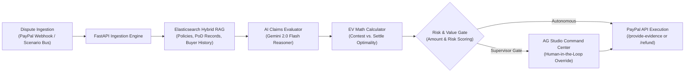

# Sentin AI

> **Autonomous Dispute Resolution & Risk Operations Platform for Modern Commerce**

[](LICENSE)
[](https://fastapi.tiangolo.com/)
[](https://nextjs.org/)
[](https://www.elastic.co/)
[](https://www.ag-grid.com/)

---

## Overview

Online merchants face escalating chargebacks across *Item Not Received (INR)* and *Significantly Not As Described (SNAD)* claims. Each unresolved dispute incurs non-refundable network dispute fees ($15–$20), manual evidence assembly fatigue, and merchant risk score penalties.

**Sentin AI** is an autonomous risk operations command center. It monitors dispute events, retrieves store policies and courier proof-of-delivery (PoD) records via **hybrid search (RAG)**, calculates optimal resolution strategies using **Expected Value (EV)** economics, and programmatically executes dispute responses (Contest vs. Settle vs. Refund) while providing an executive command matrix.



---

## Core Capabilities

- **Autonomous Claim Defense**: Conclusive delivery proof (carrier tracking with signature confirmation) triggers instant, automated submission of evidence packages.
- **Mathematical Expected Value (EV) Arbitrator**: Evaluates dispute probability against network chargeback fees to maximize merchant capital preservation:
  $$\text{EV}(\text{Contest}) = P(\text{win}) \cdot \text{Amount} - (1 - P(\text{win})) \cdot (\text{Amount} + \text{Fee}) - \text{Labor}$$
- **Hybrid Context Search (RAG)**: Indexes store return protocols, shipping SLAs, carrier tracking logs, and buyer dispute histories.
- **Human-in-the-Loop Safeguards**: High-value claims or borderline cases automatically route to the AG Studio dashboard for supervisor authorization.
- **Enterprise Command Matrix**: Filterable, sortable operational grid with slide-out inspection drawers showing real-time evidence and audit logs.

---

## Tech Stack

| Layer | Technology |
|---|---|
| **Frontend** | Next.js 14 (App Router), React 18, Tailwind CSS, AG Studio / AG Grid React, Lucide Icons |
| **Backend** | Python 3.11, FastAPI, SQLAlchemy 2.0 (Async), Pydantic v2, Alembic |
| **Search & RAG** | Elasticsearch 8.x (Hybrid BM25 + Vector) with local NumPy fallback |
| **AI Engine** | Google Gemini 2.0 Flash via `google-genai` SDK |
| **Payments** | PayPal REST APIs (Customer Disputes v1 & Payments v2 Captures) |
| **Database** | PostgreSQL 16 |

---

## Quick Start Guide

### Prerequisites
- Docker & Docker Compose
- Node.js 20+ & npm 10+
- Python 3.11+

### 1. Start Infrastructure (PostgreSQL & Elasticsearch)
```bash
docker compose up -d db elasticsearch
```

### 2. Launch Backend API
```bash
cd backend
cp .env.example .env
pip install -r requirements.txt
python -m uvicorn app.main:app --reload --port 8000
```
Interactive API documentation will be available at `http://localhost:8000/docs`.

### 3. Launch Frontend Command Center
```bash
cd frontend
cp .env.example .env.local
npm install --legacy-peer-deps
npm run dev
```
The Command Center will be running at `http://localhost:3000`.

---

## Project Structure

```
├── backend/
│   ├── app/
│   │   ├── api/            # Route controllers (disputes, webhooks, simulation)
│   │   ├── core/           # Config, database engine, PayPal client
│   │   ├── engine/         # AI claims agent, EV calculator, RAG store
│   │   └── models/         # Pydantic schemas & SQLAlchemy ORM models
│   ├── alembic/            # Database schema migrations
│   └── seed/               # Realistic policy & carrier tracking fixtures
├── frontend/
│   ├── src/
│   │   ├── app/            # Next.js App Router pages & layout
│   │   ├── components/     # AG Studio matrix, inspection drawer, KPI bar
│   │   └── lib/            # Typed API client & constants
└── docker-compose.yml      # Local development environment
```

---

## Contributing & Development

For developer guidelines, branching conventions, and release schedules, refer to [DEVELOPMENT.md](DEVELOPMENT.md).

---

## License

This project is licensed under the MIT License — see the [LICENSE](LICENSE) file for details.
